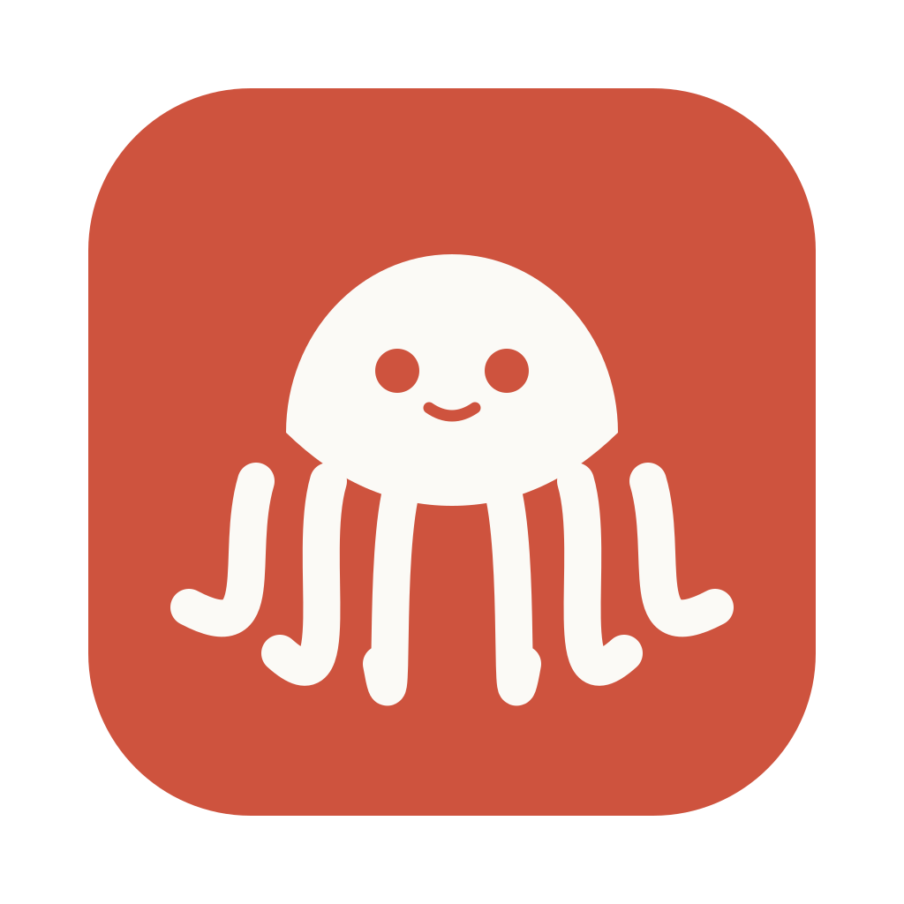

<div align="center">
  
  <h1>Tako · 章鱼</h1>
  <p>多触手聚合翻译：划词即译，即用即走。<br/>A multi-provider translation companion — select, translate, move on.</p>
  <p>
    <a href="LICENSE"></a>
    
    
    
  </p>
  <p><b>简体中文</b> · <a href="#english">English</a></p>
</div>

---

Tako 是一款跨平台桌面翻译工具，对标 [Bob](https://bobtranslate.com/) 的核心体验：划词翻译、输入翻译、多翻译服务聚合对照（多开）、历史记录与收藏、托盘常驻。所有 UI 与资源原创，不接遥测、不收集任何数据。

## 功能

- **划词翻译**：选中文本按快捷键，浮窗显示译文（模拟复制取词，窗口期 < 100ms）
- **输入翻译**：快捷键唤起输入窗，输入即译
- **多服务聚合对照**：DeepL Free / Google / Microsoft / OpenAI 兼容接口（自定义 baseUrl，覆盖 Claude、Gemini 及国产模型），多开对照，LLM 流式输出
- **历史与收藏**：本地 SQLite 存储，按时间/服务过滤、收藏置顶
- **托盘常驻**：菜单栏快捷入口；浮窗可钉住、失焦自动隐藏

规划中（二期）：截图 OCR 翻译、TTS 朗读、无障碍 API 直读取词、插件系统。

## 技术栈

| 层 | 选型 |
|---|---|
| 桌面壳 | Wails 3（锁 v3.0.0-beta.28）+ Go ≥ 1.27 |
| 前端 | Vue 3.5 + Vite + TypeScript + Tailwind v4 + shadcn-vue（reka-ui）+ Pinia |
| 存储 | modernc.org/sqlite（纯 Go，无 cgo） |
| 工具链 | Bun + Makefile 编排，Vitest + go test |

## 仓库结构

```
tako/
├── apps/desktop/          # Wails 3 应用
│   ├── main.go            # 入口、窗口注册、服务装配
│   ├── internal/          # Go 模块：provider / selection / store / clipboardx / hotkey / license / bridge
│   └── frontend/          # Vue 应用（feature-first）
├── packages/contracts/    # 前后端桥接契约（唯一共享依赖，主线维护）
├── docs/spec/             # SPEC-A（Go 后端）/ SPEC-B（前端）分工规格
└── docs/agents/           # 分场景开发规范
```

## 开发

```bash
bun install --cwd apps/desktop/frontend   # 首次
make dev      # wails3 dev 热重载
make ci       # 前端 lint/typecheck/test + Go vet/test（push 前必跑）
make build    # 当前平台安装包（macOS → dmg；Windows → nsis）
make generate # bridge 契约变更后重新生成 bindings（产物入库）
```

前置：Go ≥ 1.27、Bun ≥ 1.4、wails3 CLI（`go install github.com/wailsapp/wails/v3/cmd/wails3@v3.0.0-beta.28`）。

## 协作

- 分支：`main`（主线）/ `feat/backend` / `feat/frontend`
- 边界：后端只写 `apps/desktop/internal/**`；前端只写 `frontend/src/{app,components,features}/**`；`packages/contracts` 仅主线可改
- 规范见 `AGENTS.md` 与 `.agents/skills/`，分工规格见 `docs/spec/`

## License

[Apache-2.0](LICENSE) © 2026 wonderjun

---

<h2 id="english">English</h2>

Tako is a cross-platform desktop translator matching the core experience of Bob: selection translation, quick-input translation, multi-provider side-by-side comparison, history & favorites, and a tray-resident presence. All UI and assets are original; no telemetry, no data collection.

**Features**

- **Selection translation** — hotkey translates selected text in a floating popup (<100ms clipboard window)
- **Quick input** — hotkey summons an input window, translate as you type
- **Multi-provider comparison** — DeepL Free / Google / Microsoft / OpenAI-compatible endpoints (custom baseUrl covers Claude, Gemini and CN models); LLM streaming output
- **History & favorites** — local SQLite, filterable by time and provider
- **Tray-resident** — pinnable popups that auto-hide on focus loss

**Stack**: Wails 3 (v3.0.0-beta.28) + Go ≥ 1.27 · Vue 3.5 + Vite + TS + Tailwind v4 + shadcn-vue + Pinia · modernc.org/sqlite · Bun + Make.

**Develop**

```bash
bun install --cwd apps/desktop/frontend
make dev / ci / build / generate
```

Requires Go ≥ 1.27, Bun ≥ 1.4, and `wails3` CLI.

Licensed under [Apache-2.0](LICENSE).
